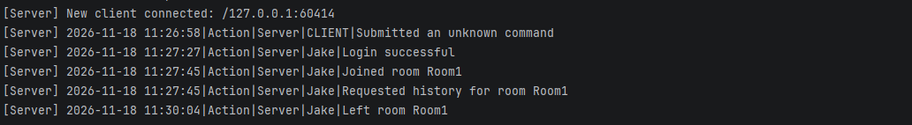
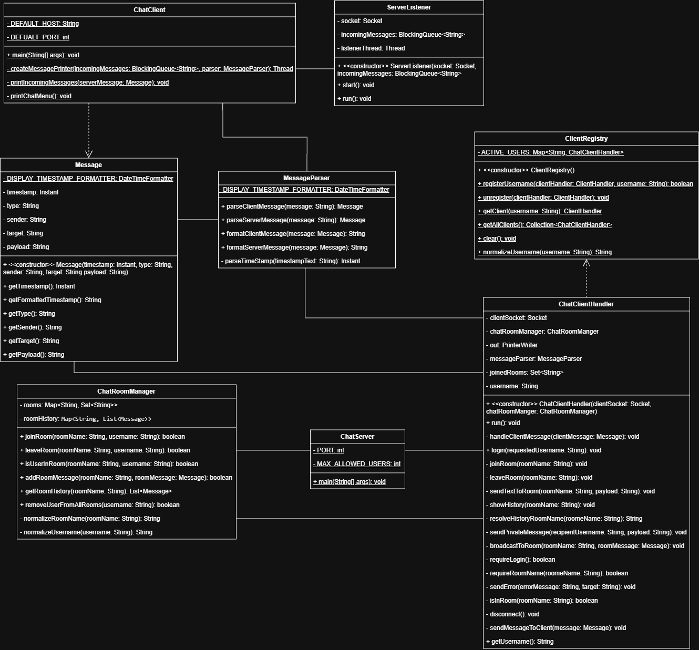
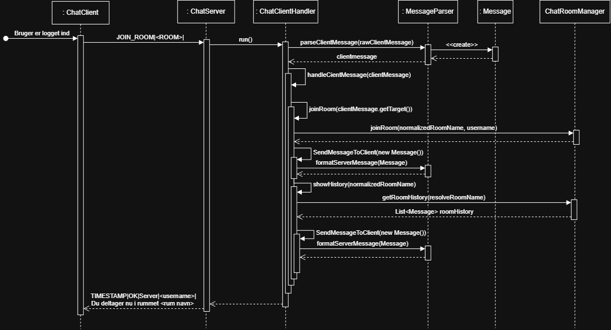

# Chat Program (Java)
> A simple console-based chat program where multiple clients communicate with each other through a server.

## AI
| Task | AI tool | AI suggestion | Evaluation and changes | Verification and testing |
|------|----------|---------------|-------------------------|-------------------------|
| Issue 15 ServerListener | GitHub Copilot | AI suggested a suitable plan. | We considered the plan suitable. | The test was unmarked. While reviewing the code, we discovered that it had created a method in both the handler and the server. We corrected this and received an explanation that it was a mistake. |
| Multiple issues | GitHub Copilot | AI proposed a plan that looked suitable but had not inspected the classes it needed to use. | We told the AI to inspect the classes before proposing a plan for our program. | We did not complete this part. |
| Extension | GitHub Copilot | The credit limit prevented us from using the first AI to implement, so we used its plan with another AI to produce the implementation. | The implementation worked and could be used for the extension. | We tested the implementation and it worked. |

## Tests
| Test | Expected result |
|------|-----------------|
| Three clients connect simultaneously | All three clients can connect. |
| Two users select the same username | The second user receives an error message. |
| A user sends a message in a room | Only users in that room receive the message. |
| A user sends a private message | Only the specified recipient can see the message. |
| A client sends a malformed message | The server sends an error and continues running. |
| A client disconnects unexpectedly | The server removes the client from the registry. |
| A user joins a room | The user can see the room history. |

## Startup guide & Protocol description
### Instructions for starting the program 

1. Run the server's main method.
2. If the port is in use, change the constant named `PORT` in both the server and the client.
3. Run the client's main method.

### Protocol description
- Our protocol is implemented by `MessageParser`.
- It converts raw text into fields that the program uses to determine what action should occur.
- The server sends messages using `TIMESTAMP|TYPE|SENDER|TARGET|PAYLOAD`, for example `TIMESTAMP|PRIVATE|FRANK|BOB|hello bob`.
- The protocol has two main formats: clients use `TYPE|TARGET|PAYLOAD`, while servers use `TIMESTAMP|TYPE|SENDER|TARGET|PAYLOAD`.
- Server action logs use the same server format but contain a generic action as the payload. They do not expose the actual chat message.

#### Server-logging

This is an example of how the server logs a user's actions using the server protocol.

## Thread model and shared resources
The application uses multithreading, allowing it to handle several tasks simultaneously instead of waiting for one task to finish before starting another.
An `ExecutorService` limits the number of client handler threads.

## Selected extension
`Chat room message history`

We selected message history because it improves the chat experience by letting users see previous activity after joining a room.
Users can view the history when joining a room or by using the history command.
The server verifies that the user is a member of the room and handles an empty room history correctly.
Private messages are not included because the extension is limited to room history.

### Class diagram

### Sequence diagram
